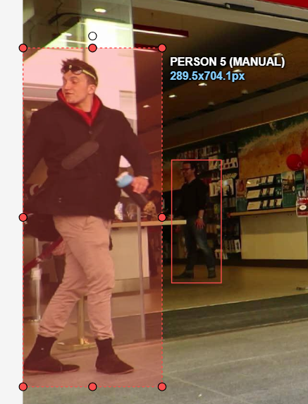
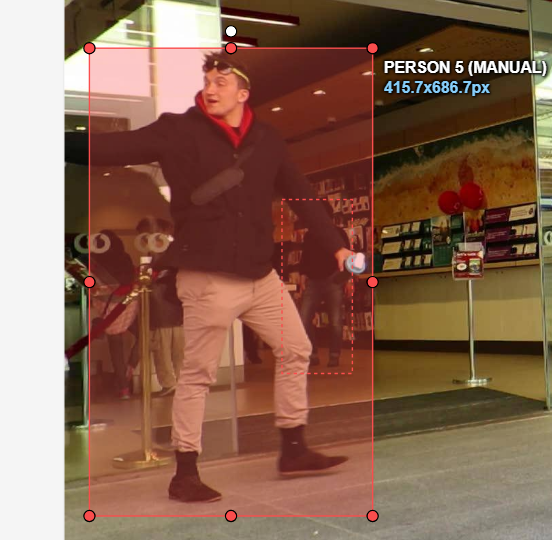
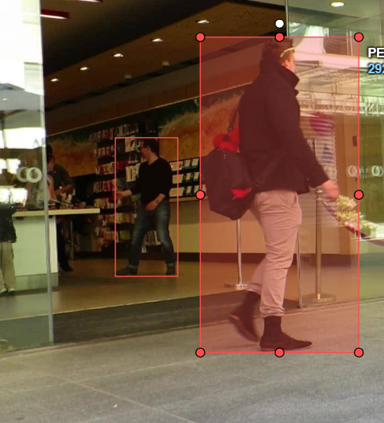

# Báo cáo cá nhân — HoVaTen-MSSV

Đổi tên file theo quy tắc `MSSV_HoTen.md`. Ví dụ: `20241234_NguyenVanAn.md`.

Đoạn video: MOT17-09, 150 frame (frame 1–150), nguồn MOTChallenge, giấy phép CC BY-NC-SA 3.0.

## 0. Thông tin học viên

- Họ tên:Nguyễn Tuấn Dũng 
- MSSV: 2A202603345
- Mã đề (A/B/C):C
- Email:dungn201100@gmail.com 
- Link repository:https://github.com/dungn201100-eng/K5-L2B-Day05-NguyenTuanDung-03345-MOTTracking.git
- Giờ bắt đầu: 16h30
- Giờ kết thúc: 18h

## 1. Xem trước đoạn video (CP0)

Ghi **trước khi vẽ**, mỗi người một dòng.

| Mã | Frame xuất hiện | Frame cuối thấy được | Rẽ / dừng / đổi tốc độ ở frame | Bị che ở frame | Ghi chú |
|---|---|---|---|---|---|
| P1 |0 |149 |20 | 39| |
| P2 |60 |149 | | 0| |
| P3 |20 | 149| |0 | |
| P4 |0 |99 | | 105| |
| P5 |0 |109 |50 |119 | |

## 2. Keyframe và thời gian (CP1, CP4)

Số keyframe lấy từ kết quả `src/check_submission.py`.

| Mã | Số keyframe | Keyframe ở frame | Số frame có mặt | Keyframe / 100 frame | Thời gian (phút) | Chỗ khó |
|---|---|---|---|---|---|---|
| P1 | 15 | 0, 10, 20, 30, 50, 59, 60, 70, 80, 90, 100, 120, 130, 140, 149 | 139 | 10.8 | 10 | Bị che khuất (occluded 18 frame) và khuất hẳn (`outside` frame 39–49), phải khóa mốc trước và sau khi hiện lại |
| P2 | 9 | 60, 70, 80, 90, 100, 110, 130, 140, 149 | 90 | 10.0 | 6 | Xuất hiện muộn ở frame 60, có đoạn bị che nhẹ (`occluded` 10 frame) |
| P3 | 14 | 20, 30, 40, 50, 60, 70, 80, 90, 100, 110, 120, 130, 140, 149 | 130 | 10.8 | 8 | Bị che một phần nhiều đoạn (`occluded` 50 frame) khi người khác đi ngang qua |
| P4 | 7 | 0, 10, 20, 30, 40, 90, 100 | 110 | 6.4 | 7 | Đi thẳng đều đoạn giữa (frame 40–90) và rời khỏi khung hình (`outside`) tại frame 110 |
| P5 | 14 | 0, 4, 10, 20, 30, 40, 50, 60, 70, 80, 90, 100, 110, 130 | 128 | 10.9 | 9 | Bị che nhiều (`occluded` 42 frame), khuất hẳn đoạn 119–129 và rời khung hình ở frame 139 |
| **Tổng** | **59** | — | **597** | **9.9** | **40** | — |

Keyframe / 100 frame của cả bài = tổng keyframe ÷ tổng số frame có mặt × 100 = 59 ÷ 597 × 100 = 9.9

Bạn đặt keyframe nhiều nhất ở người nào? Vì sao (người đó rẽ, dừng, lại gần camera hay bị che)?

Người đặt nhiều keyframe nhất là **P1** với **15 keyframe** (và nếu xét theo mật độ trên 100 frame thì **P5** cao nhất với **10.9 KF/100 frame**, sát nút với P1 là **10.8 KF/100 frame**). Nguyên nhân là vì P1 xuất hiện gần như xuyên suốt toàn bộ video (139 frame) và có đoạn **bị che khuất hoàn toàn từ frame 39 đến 49**, buộc phải đặt các keyframe sát điểm trước khi khuất (frame 30) và ngay khi hiện lại (frame 50, 59, 60) để điều chỉnh kích thước box khớp với người, tránh để nội suy tuyến tính làm box bị trôi hoặc méo.

## 3. Đoạn bị che (CP2)

Người bị che: `P1`

| Mốc | Frame |
|---|---:|
| Bắt đầu bị che một phần (bật `occluded`) | 25|
| Mất hẳn (bật `outside`) |39 |
| Hiện lại (tắt `outside`) |50 |
| Thấy rõ trở lại (tắt `occluded`) |56 |

- Thời gian khuất hẳn: __11_ frame = _1__ giây.
- Quyết định: giữ cùng ID 
- Lý do (trả lời 3 câu: khuất bao lâu so với 60 frame, ngoại hình có khớp, chỗ hiện lại có đúng hướng và tốc độ):
   1. **Thời gian khuất so với ngưỡng 60 frame:** P1 chỉ bị khuất hoàn toàn (`outside`) trong **11 frame** (từ frame 39 đến frame 49, tương đương khoảng **0,37 giây** ở 30 fps), ngắn hơn rất nhiều so với ngưỡng quy định **60 frame** (2 giây).
  2. **Ngoại hình:** Khi xuất hiện lại ở frame 50, đối tượng có trang phục, màu sắc quần áo và vóc dáng trùng khớp hoàn toàn với P1 trước thời điểm bị che.
  3. **Vị trí, hướng và tốc độ khi hiện lại:** Vị trí P1 lộ diện ở frame 50 nằm đúng trên quỹ đạo tiếp nối từ điểm biến mất trước đó (frame 38), duy trì đúng hướng di chuyển và tốc độ đi bộ ổn định như ban đầu.

...

Ảnh chụp màn hình:





## 4. Tự review ID (CP3)

Lượt 1 theo người (đi ngược từ frame 149 về 0 trên CVAT), lượt 2 theo cảnh (nhảy 10 frame). Ít nhất 3 dòng; không có lỗi thì ghi một dòng "đã kiểm hai lượt, không lỗi".

Loại lỗi dùng đúng một trong 7 mã: `id_switch`, `fragmentation`, `lost`, `merge`, `false_track`, `drift`, `flag`.

| Frame | Mã người | Loại lỗi | Mô tả một câu | Phát hiện ở lượt | Đã sửa? |
|---:|---|---|---|---|---|
| 4 | P5 | `drift` | Box bị trôi nhẹ lệch khỏi chân P5 do nội suy tuyến tính đoạn đầu nên đã chèn thêm keyframe chỉnh lại. | Lượt 1 | Có |
| 59 | P1 | `drift` | Sau khi P1 hiện lại từ đoạn khuất, box bị lệch nhẹ khi thay đổi kích thước nên đã thêm keyframe ôm sát người. | Lượt 1 | Có |
| 80 | P3 | `flag` | P3 bị người khác đi ngang che một phần cơ thể nhưng chưa bật cờ `occluded` ở đoạn giao nhau. | Lượt 2 | Có |

Tổng hợp số lỗi theo loại:

| `id_switch` | `fragmentation` | `lost` | `merge` | `false_track` | `drift` | `flag` |
|---:|---:|---:|---:|---:|---:|---:|
| 0 | 0 | 0 | 0 | 0 | 2 | 1 |

Lỗi nào chỉ lượt 2 (theo cảnh) mới thấy, lượt 1 (theo người) không thấy? Vì sao?

Các lỗi chỉ dễ dàng phát hiện ở **lượt 2 (nhìn toàn cảnh cả 5 box cùng lúc)** mà **lượt 1 (chỉ theo dõi đơn lẻ từng người)** dễ bỏ sót là **`merge`** (hai track cùng gán đè lên một người), **`false_track`** (box thừa hoặc gán nhầm sang người ngoài danh sách P1–P5) và **`id_switch`** (hai người mặc đồ giống nhau đi cắt ngang và bị đổi chéo ID cho nhau). 

Vì sao: Ở lượt 1, mắt người review chỉ tập trung bám theo quỹ đạo của **một đối tượng duy nhất** trong cô lập nên không thấy được sự tương quan với các box còn lại trong cùng khung hình (nếu track bị nhảy sang người bên cạnh mặc đồ tương tự, nhìn riêng lẻ vẫn thấy box đang bám đúng một người đi bộ). Sang lượt 2, khi quan sát đồng thời tất cả các box trên toàn cảnh, ta sẽ phát hiện ngay lập tức sự bất thường về số lượng và phân bố: một người bị **2 box chồng lên nhau** trong khi một người mục tiêu khác lại bị **trống (không có box)**, hoặc thấy rõ cặp ID vừa hoán đổi vị trí cho nhau.

## 5. File xuất và kết quả tự kiểm (CP4)

| Kiểm tra | Kết quả |
|---|---|
| Tên file MOT 1.1 |`src/exports/NguyenTuanDung_mot.zip` |
| Tên file CVAT for video 1.1 | `src/exports/NguyenTuanDung_cvat_video.zip`|
| Số track ID khác nhau trong `gt/gt.txt` (phải là 5) |5 |
| Frame `outside` không có dòng trong `gt.txt` (đúng / sai) |Đúng |
| Job đã completed trên CVAT máy cá nhân |Complete |

Dán phần tóm tắt in ra từ `src/check_submission.py`:

```text
Số frame in theo CVAT (bắt đầu từ 0). Trong gt.txt, frame_id = frame CVAT + 1.

=== File MOT 1.1: NguyenTuanDung_mot.zip ===
  Số track ID: 5   |   Tổng số box: 597
  [OK]        Đúng 5 track ID.

  Track | Frame có mặt | Số frame | Đoạn vắng (outside)
      1 |   0–149      |      139 | 39–49
      2 |   0–109      |      110 | -
      3 |   0–138      |      128 | 119–129
      4 |  20–149      |      130 | -
      5 |  60–149      |       90 | -


=== File CVAT for video 1.1: NguyenTuanDung_cvat_video.zip ===

  Track | Nhãn   | Frame thấy | Keyframe | KF/100 frame | Frame occluded | Lần bật outside
      0 | person |        139 |       15 |         10.8 |             18 |               1
              Track 0: keyframe ở frame [0, 10, 20, 30, 50, 59, 60, 70, 80, 90, 100, 120, 130, 140, 149]
      1 | person |         90 |        9 |         10.0 |             10 |               0
              Track 1: keyframe ở frame [60, 70, 80, 90, 100, 110, 130, 140, 149]
      2 | person |        130 |       14 |         10.8 |             50 |               0
              Track 2: keyframe ở frame [20, 30, 40, 50, 60, 70, 80, 90, 100, 110, 120, 130, 140, 149]
      3 | person |        110 |        7 |          6.4 |             20 |               1
              Track 3: keyframe ở frame [0, 10, 20, 30, 40, 90, 100]
      4 | person |        128 |       14 |         10.9 |             42 |               2
              Track 4: keyframe ở frame [0, 4, 10, 20, 30, 40, 50, 60, 70, 80, 90, 100, 110, 130]

  Tổng: 59 keyframe / 597 frame có mặt = 9.9 keyframe / 100 frame
  [OK]        Đọc được 5 track từ annotations.xml.

=== Tóm tắt ===
  Lỗi: 0   |   Cảnh báo: 0
  Đạt. Dán phần tóm tắt này vào báo cáo mục 5.

## 6. Ba câu kết

1. Nếu được gán lại, bạn sẽ đặt keyframe khác ở đâu? Vì sao?

   Nếu được gán lại, tôi sẽ giảm bớt các keyframe đặt rải đều theo bước nhảy 10 frame của phím `V` trên những đoạn đi thẳng đều (như ở **P2** và **P3** có keyframe gần như mỗi 10 frame dù quỹ đạo khá tuyến tính), đồng thời đặt keyframe sát đúng vào **các frame bản lề thực tế** thay vì dừng ở mốc chẵn chục. Cụ thể, với **P1**, tôi sẽ đặt thêm một keyframe ngay tại **frame 38** (frame cuối cùng trước khi bật `outside` ở frame 39) thay vì để khoảng cách nội suy từ frame 30 đến 38, và căn chỉnh chính xác ngay tại **frame 50** khi P1 vừa lộ diện. Việc đặt keyframe đúng điểm uốn (bắt đầu rẽ, đổi tốc độ, hoặc ranh giới trước/sau khi khuất) giúp tận dụng tối đa nội suy tuyến tính, giảm tổng số keyframe thừa mà box vẫn bám sát người hơn.

2. Có chỗ nào bạn không chắc "cùng ID hay ID mới"? Bạn đã quyết định và ghi chú thế nào?

Có hai đoạn cần cân nhắc kỹ là lúc **P1 bị khuất hoàn toàn từ frame 39 đến 49** (11 frame) và **P5 bị khuất từ frame 119 đến 129** (11 frame) do người đi bộ khác đi cắt ngang trong cảnh đông đúc và trang phục tối màu khá giống nhau. Tôi đã đối chiếu theo 3 tiêu chí của lớp: (1) thời gian khuất của cả hai trường hợp đều là **11 frame (~0,37 giây)**, ngắn hơn rất nhiều so với ngưỡng **60 frame (2 giây)**; (2) trang phục, dáng người khi lộ diện lại khớp hoàn toàn; và (3) vị trí xuất hiện lại (frame 50 với P1, frame 130 với P5) nằm đúng trên quỹ đạo và tốc độ di chuyển trước đó. Vì vậy, tôi quyết định **giữ cùng Track ID** bằng cách bật cờ `outside` trong đoạn khuất thay vì tạo ID mới, đồng thời ghi chú rõ khoảng frame khuất và lý do giữ ID vào Mục 3 cũng như phần ghi chú của object trên CVAT.

3. Một lỗi ID trong job của bạn (nếu không còn sót, chọn lỗi đã sửa) có thể làm xe tự lái dự đoán sai chuyển động của người đó như thế nào? Lỗi đó ảnh hưởng MOTA hay IDF1 nhiều hơn?

   Lấy ví dụ lỗi **`drift` (lệch/giật kích thước box) ở frame 59 của P1** ngay sau đoạn khuất (hoặc nếu để xảy ra **`id_switch`** tại điểm giao cắt với người đi ngược chiều ở **frame 80 của P3**): bộ dự đoán quỹ đạo trên xe tự lái tính vận tốc và hướng di chuyển của người đi bộ dựa trên độ dịch chuyển tâm box giữa các frame liên tiếp ($\vec{v} = \Delta\vec{x} / \Delta t$). Khi box bị giật vị trí đột ngột hoặc đổi nhầm ID sang người đi hướng khác, hệ thống sẽ tính ra một vector vận tốc phi thực tế (ví dụ nhảy 1,5 m chỉ trong 1/30 giây, tương đương ~162 km/h) hoặc hiểu nhầm người đang đi song song trên vỉa hè bỗng lao cắt ngang đầu xe — dẫn tới việc xe **phanh gấp nhầm (phantom braking)** hoặc ngược lại, đánh giá sai hướng di chuyển thực của người đi bộ và không giảm tốc kịp thời.

Lỗi này ảnh hưởng đến **IDF1 nhiều hơn hẳn so với MOTA**:
   - **MOTA** chủ yếu đo chất lượng phát hiện từng frame riêng lẻ và chỉ trừ điểm một lần tại đúng frame xảy ra chuyển đổi (`IDSW = 1`); các frame phía sau dù mang sai ID nhưng box vẫn phủ lên người thì vẫn được tính là phát hiện đúng (`TP`), nên chỉ số MOTA giảm rất ít.
   - **IDF1** đo độ nhất quán của một Track ID xuyên suốt toàn bộ chuỗi video; một khi ID bị đứt hoặc hoán đổi giữa chừng, toàn bộ chuỗi frame phía sau đều bị lệch khỏi ID gốc, làm điểm IDF1 sụt giảm mạnh.
## Bonus (nếu làm)

### B1 — Hai người đi sát

...

### B2 — So cách đặt keyframe

| Cách đặt | Số keyframe | Frame trôi nhất | Ghi chú |
|---|---:|---:|---|
| Đều mỗi 30 frame | | | |
| Theo chỗ đổi hướng | | | |

...

### B3 — So với tracker có sẵn

| Frame | Mã người | Tracker làm gì | Nhãn của bạn | Giải thích (đoán rồi sửa / ghép IoU / box score thấp / ngoại hình) |
|---:|---|---|---|---|
| | | | | |
| | | | | |

## 7. Tài liệu tham khảo và công cụ AI đã dùng

...
